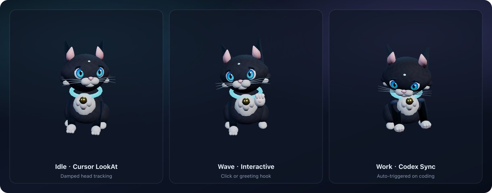
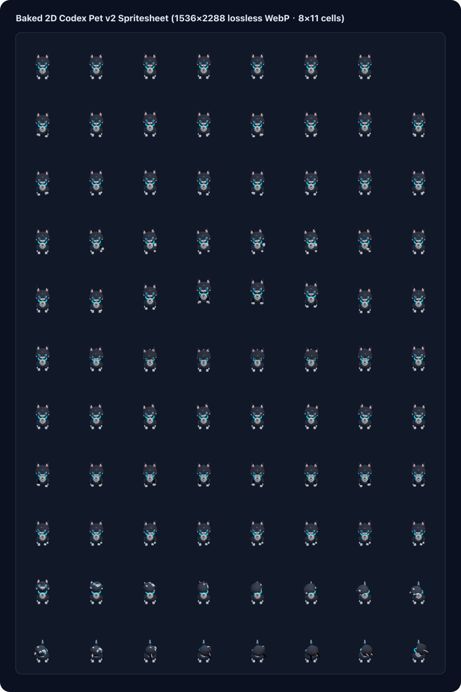
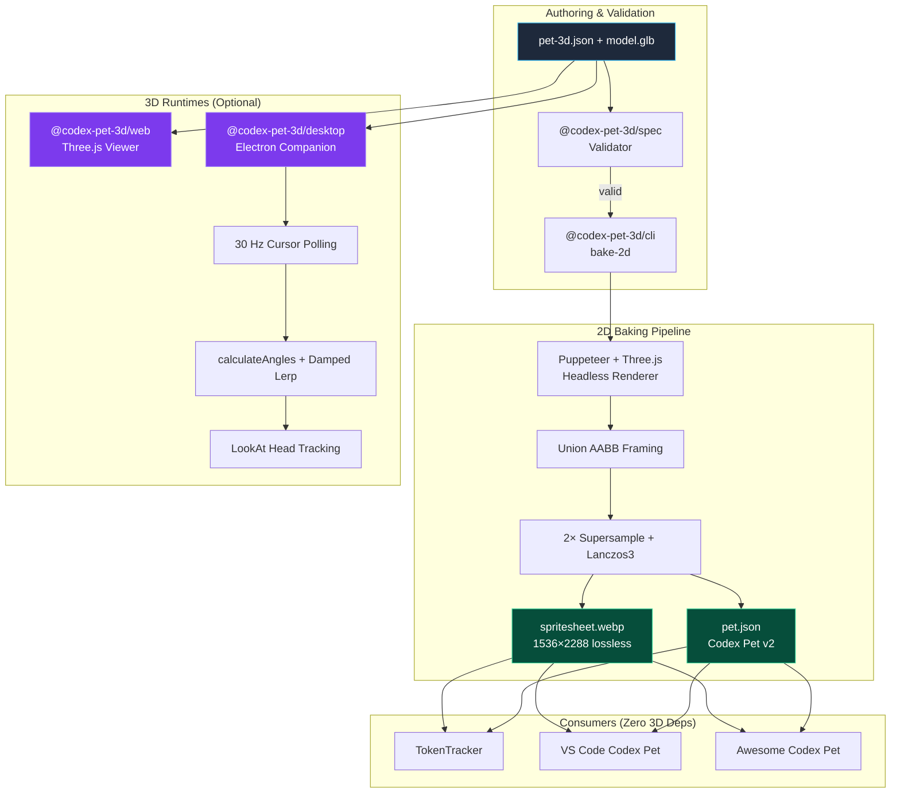
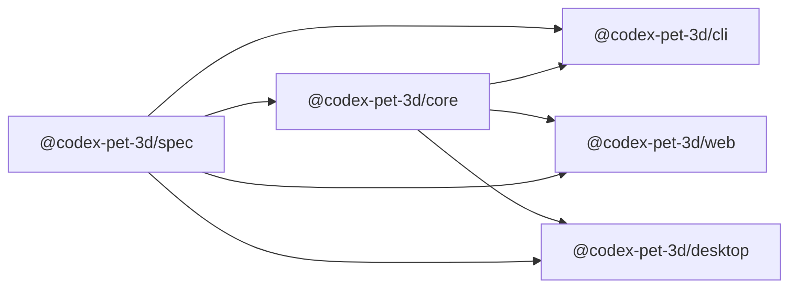

# Codex Pet 3D

[](https://opensource.org/licenses/MIT)
[](https://nodejs.org/)
[](https://pnpm.io/)
[](https://www.typescriptlang.org/)
[](https://vitest.dev/)
[](https://igloo302.github.io/codex-pet-3d/)

**Codex Pet 3D** extends the [Awesome Codex Pet](https://github.com/legeling/awesome-codex-pet) 2D format into interactive 3D — while guaranteeing **100% backwards compatibility** with existing 2D clients (TokenTracker, VS Code pets, Awesome Codex Pet).

Author a rigged, animated 3D pet once → inspect & author in the **[Live Web Studio](https://igloo302.github.io/codex-pet-3d/)** → bake to a standards-compliant 2D spritesheet → run natively as a desktop companion with cursor-following LookAt and real-time Codex status sync.



<details>
<summary>View baked 2D Codex Pet v2 spritesheet (1536×2288 lossless WebP)</summary>



</details>

---

## Architecture Overview



**Key property:** The 2D baking pipeline (green) produces artifacts consumable by **any** existing Codex Pet v2 client. The 3D runtimes (purple) are purely additive.

---

## Package Matrix

| Package | Scope | Purpose | Entry Point |
|---------|-------|---------|-------------|
| `@codex-pet-3d/spec` | `packages/spec` | Schema, types, GLB inspection, validation | `dist/index.js` |
| `@codex-pet-3d/core` | `packages/core` | Pure math: `calculateAngles`, LookAt, state machine | `dist/index.js` |
| `@codex-pet-3d/cli` | `packages/cli` | `validate`, `bake-2d`, `install` commands | `dist/cli.js` (bin) |
| `@codex-pet-3d/web` | `packages/web` | Interactive 3D viewer (Vite + React + Three.js) | `index.html` |
| `@codex-pet-3d/desktop` | `packages/desktop` | Electron frameless companion with LookAt | `dist/main.js` |

### Dependency Graph



---

## Quick Start

### Prerequisites

- Node.js ≥ 20
- pnpm ≥ 9
- Google Chrome (for `bake-2d` headless rendering)

### Installation

```bash
# Clone & install
git clone https://github.com/Igloo302/codex-pet-3d.git
cd codex-pet-3d
pnpm install

# Build all packages
pnpm run build
```

### Validate a 3D Asset

```bash
# Human-readable output
pnpm run validate assets/cyber-cat

# JSON output (CI-friendly)
pnpm run validate assets/cyber-cat --json
```

**Expected output (JSON):**
```json
{
  "valid": true,
  "exitCode": 0,
  "errors": [],
  "warnings": []
}
```

### Bake to 2D (Codex Pet v2)

```bash
pnpm run bake-2d assets/cyber-cat --out ./dist
```

**Outputs:**
```
dist/
├── spritesheet.webp   # 1536×2288 lossless WebP
└── pet.json           # Codex Pet v2 manifest
```

### Run the Web Authoring Studio

```bash
pnpm run web
# Opens http://localhost:5173
```

Or use the hosted studio on GitHub Pages: **https://igloo302.github.io/codex-pet-3d/**

The Web Studio supports:
- Drag-and-drop `.glb` (and optional `pet-3d.json`) with live in-browser spec budget validation (vertices, triangles, texture size, file size, skeleton, clips)
- Interactive `head_bone` selection, LookAt angle sliders, and 9-state animation clip mapping
- Toggle between **LookAt Preview** and **Orbit Framing** (`OrbitControls`) synced directly to `camera.position` / `camera.target`
- One-click **Copy / Download `pet-3d.json`**

#### Immersive WebXR (AR / VR)

The studio exposes an optional WebXR layer built on the same `Pet3DController`:

- **`immersive-ar`** — hit-test surface placement with a cyan reticle, transparent passthrough, and a DOM-overlay HUD for *Move Pet* (tap to place), scale ±, recenter and quick animations. The pet's head follows your headset via 3D gaze LookAt.
- **`immersive-vr`** — a grounded cyber-studio stage (ring + grid) beneath the pet, controller ray lines, and trigger/squeeze interaction that cycles playful reactions. 3D gaze LookAt keeps the pet's head facing you.
- **HTTPS required** — WebXR only works in a secure context, so serve the studio over HTTPS or `http://localhost`. When no immersive session is possible the viewport falls back to a disabled `WebXR Unavailable` / `WebXR Needs HTTPS` button with an explanatory tooltip.
- **Testing** — use a WebXR-capable headset browser (for example the Quest Browser) or install the [Immersive Web Emulator](https://chromewebstore.google.com/detail/immersive-web-emulator/cgffilbpcibhmcfbgggfhfolhkfbhmik) extension in Chrome or Edge.

### Run the Desktop Companion

```bash
pnpm run desktop
# Launches frameless Electron companion with system tray, multi-pet switcher, and Codex status sync
```

**Desktop features:**
- **Multi-Pet Switcher & Persistence**: Automatically discovers built-in assets, 3D pets installed in `~/.codex/pets/`, and any custom pet directories imported via the context/tray menu. Remembers selected pet, window position, window scale (`75%`–`150%`), LookAt, and Codex sync settings.
- **Real-Time Codex / Agent Status Sync**: Automatically reacts to AI coding activity through three channels:
  1. **Local HTTP Bridge** (`127.0.0.1:47321`, configurable via `CODEX_PET_3D_PORT`):
     ```bash
     # Notify pet that Codex/Claude is working, waiting, reviewing, succeeded, or failed
     curl -sX POST http://127.0.0.1:47321/state \
       -H 'Content-Type: application/json' \
       -d '{"state":"running","source":"codex-hook"}'
     ```
     Supported states & aliases: `idle`, `running` (`working`/`coding`/`thinking`), `waiting` (`approval`/`input`), `review` (`reviewing`), `jumping` (`success`/`done`), `failed` (`error`), `waving` (`greet`).
  2. **State JSON File**: Write `{"state":"waiting","source":"hook"}` to `~/.codex/pet-3d-state.json`.
  3. **Passive Codex Activity Detection**: Watches `~/.codex` session/log updates as a zero-config fallback.

---

## 3D Asset Authoring Guide

### Directory Structure

```
my-pet/
├── pet-3d.json      # Manifest (see SPEC.md §3)
├── model.glb        # glTF 2.0 binary, skinned, animated
└── preview.png      # Optional 512×512 thumbnail
```

### Minimal `pet-3d.json`

```json
{
  "$schema": "https://codex-pet-3d.net/schemas/pet-3d.schema.json",
  "spec_version": "3d-v1.0",
  "id": "my-pet--author",
  "display_name": "My Pet",
  "author": "author",
  "description": "A custom 3D Codex Pet",
  "model": "model.glb",
  "scale": 1.0,
  "camera": {
    "fov": 45,
    "position": [0, 1.2, 2.5],
    "target": [0, 0.4, 0]
  },
  "look_at": {
    "enabled": true,
    "head_bone": "Head",
    "max_yaw_deg": 45,
    "max_pitch_deg": 30
  },
  "animations": {
    "idle": { "clip": "Idle", "loop": true },
    "running-right": { "clip": "Run_Right", "loop": true },
    "running-left": { "clip": "Run_Left", "loop": true },
    "waving": { "clip": "Wave", "loop": false },
    "jumping": { "clip": "Jump", "loop": false },
    "failed": { "clip": "Failed", "loop": false },
    "waiting": { "clip": "Waiting", "loop": true },
    "running": { "clip": "Work", "loop": true },
    "review": { "clip": "Review", "loop": true }
  }
}
```

### GLB Requirements

| Requirement | Detail |
|-------------|--------|
| Format | glTF 2.0 binary (.glb) |
| Animation | Skeletal (skinned mesh) |
| Clips | All 9 canonical names present |
| Bone | `look_at.head_bone` must exist |
| Vertices | ≤ 25,000 |
| Triangles | ≤ 10,000 (recommended) |
| Textures | ≤ 1024×1024 |
| File size | ≤ 5 MB |
| Coordinates | Right-handed, Y-up, Z-forward (glTF default) |

---

## CLI Reference

### `codex-pet-3d validate <targetDir> [--json]`

Validates a pet-3d asset directory.

| Option | Description |
|--------|-------------|
| `<targetDir>` | Path to directory containing `pet-3d.json` |
| `--json` | Output machine-readable JSON |

**Exit codes:**
- `0` — Valid
- `1` — Validation errors (schema, budgets, missing clips/bones)
- `2` — Fatal error (missing manifest, invalid JSON, unexpected exception)

### `codex-pet-3d bake-2d <targetDir> --out <outDir>`

Bakes a validated 3D asset to Codex Pet v2 2D format.

| Option | Description |
|--------|-------------|
| `<targetDir>` | Path to validated pet-3d asset |
| `--out <outDir>` | Output directory (created if needed) |

**Behavior:**
1. Runs validation pre-flight (aborts on failure, writes nothing)
2. Launches headless Chrome (Puppeteer + SwiftShader)
3. Renders 88 frames at 2× supersample (384×416 → 192×208)
4. Composites into 1536×2288 spritesheet
5. Encodes lossless WebP + writes `pet.json` and `submission.json`

### `codex-pet-3d install <targetDir> [--target-dir <path>]`

Bakes and installs a 3D pet asset directly into local Codex (`~/.codex/pets/<id>/`).

```bash
# Quick install the official 3D Cyber Cat to Codex
pnpm run install:sample

# Or install any custom 3D asset directory
pnpm run install-codex assets/cyber-cat
```

---

## Compatibility Notes

### Codex CLI & Desktop Companion

Codex reads community and custom pets from `~/.codex/pets/<pet-id>/`.

1. Run `pnpm run install:sample` to bake and deploy `cyber-cat--jyshen` directly into `~/.codex/pets/cyber-cat--jyshen/`.
2. Ensure desktop pet overlay is enabled in `~/.codex/config.toml`:
   ```toml
   [desktop]
   avatar-overlay-pet-visible = true
   ```

### TokenTracker

TokenTracker reads the baked `pet.json` + `spritesheet.webp` directly. No changes needed.

```bash
# After baking, point TokenTracker at the dist/ directory
tokentracker add ./dist/pet.json
```

### VS Code Codex Pet Extension

Works out of the box with the baked v2 assets.

### Awesome Codex Pet

The gallery displays baked spritesheets. Submit your `dist/` folder for inclusion.

---

## Development

### Run All Tests

```bash
pnpm run test
```

### Run E2E Tests Only

```bash
pnpm run test:e2e
```

### Run Fast Unit Tests Only (No Headless Chrome)

```bash
pnpm run test:unit
```

### Type-Check All Packages

```bash
pnpm run typecheck
```

---

## Specification

The authoritative format specification is **[SPEC.md](./SPEC.md)** (v1.0, `3d-v1.0`).

Covers:
- Manifest schema & required fields
- 3D budgets (vertices, triangles, textures, file size)
- 2D baking contract (spritesheet geometry, union AABB, LookAt rows)
- Desktop companion protocol (30 Hz polling, damped LookAt)
- TokenTracker / ecosystem compatibility

---

## License

MIT © 2026 Codex Pet 3D Contributors

---

## Credits

- [Awesome Codex Pet](https://github.com/legeling/awesome-codex-pet) by legeling
- [TokenTracker](https://github.com/xiufengsun/TokenTracker) by xiufengsun
- [vscode-pets](https://github.com/tonybaloney/vscode-pets) by Anthony Shaw
- glTF / Three.js / Puppeteer / Electron communities